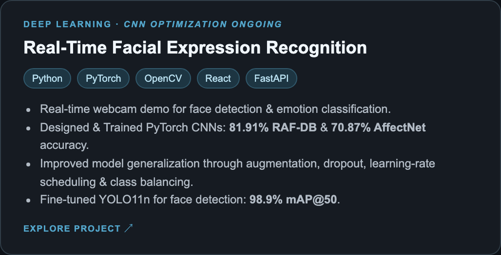
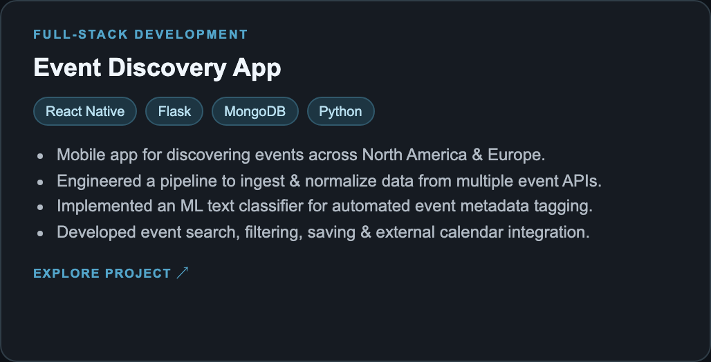
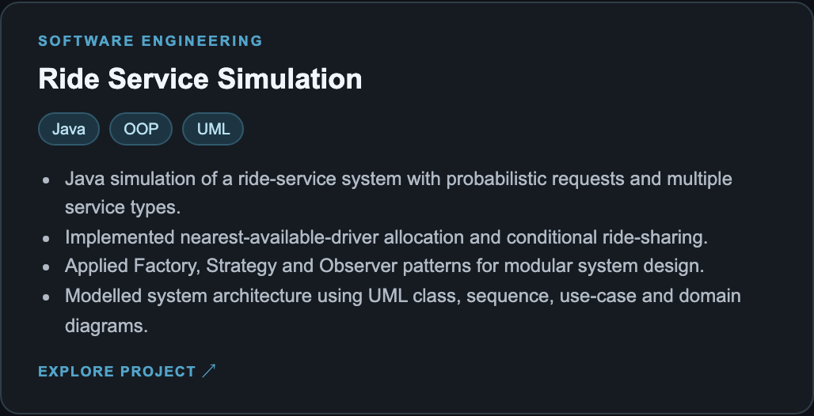
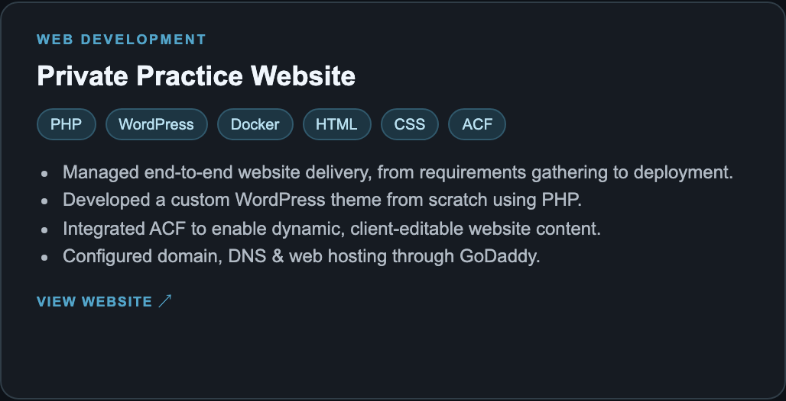
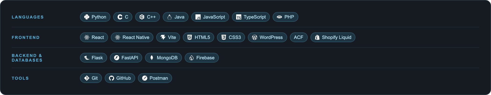

 
<h3 align="center">
  
</h3>

  

<!-- 

  BSc Computer Science · Madrid, Spain · Swedish & US Citizen

 -->

<!-- 

  
  

 -->

<!-- 

  <a href="mailto:laurenpalega333@gmail.com">Email</a>
  &nbsp;·&nbsp;
  <a href="https://linkedin.com/in/laurenpalega">LinkedIn</a>

 -->

  

  
  &nbsp;
  

---

<h3 align="left">
  
</h3>

<table>
  <tr>
    <td>
      
    </td>
    <td>
      
    </td>
  </tr>
</table>

<table>
  <tr>
    <td>
      
    </td>
    <td>
      
    </td>
  </tr>
</table>

--- 

<h3 align="left">
  
</h3>

  

